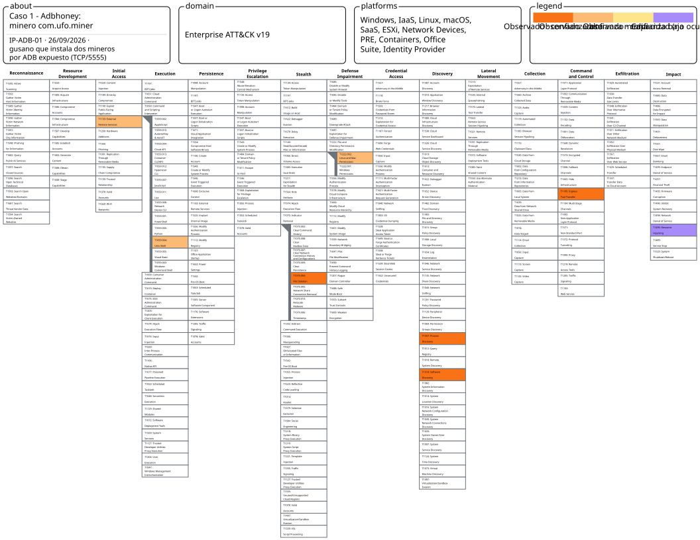
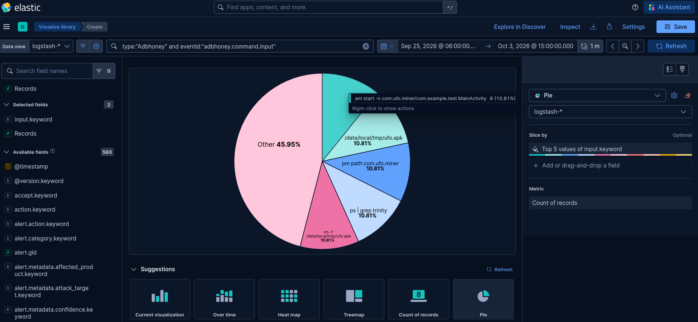
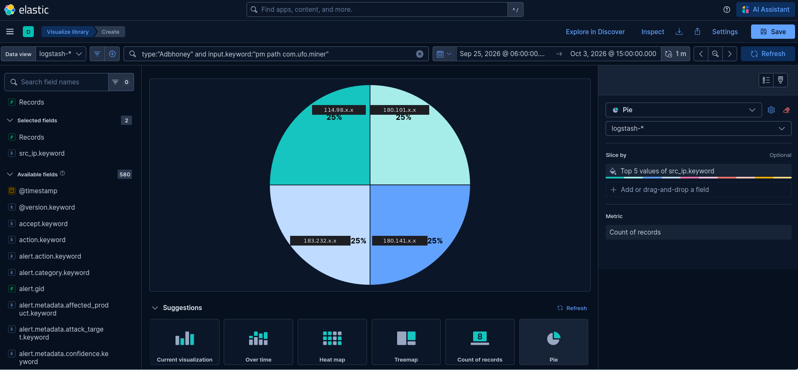
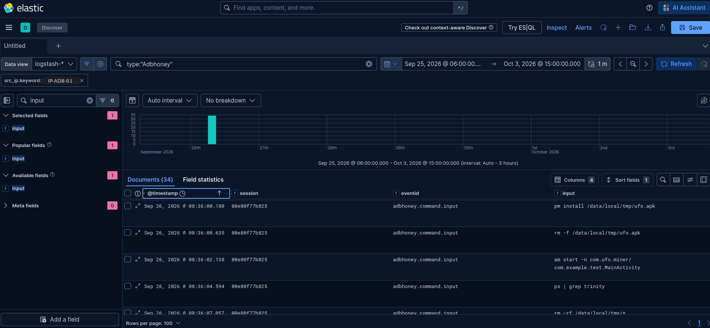
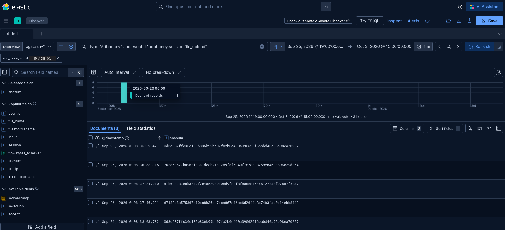
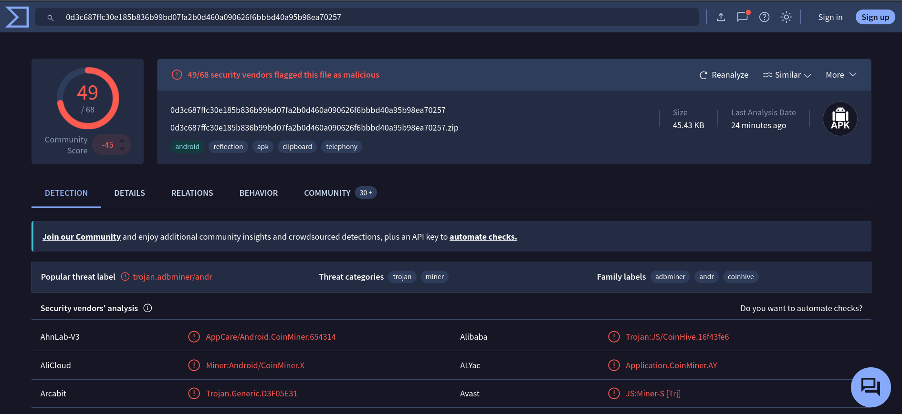

# Caso de estudio 1 – Adbhoney: crypto miner app `com.ufo.miner` por ADB expuesto

> **TL;DR:** un malware de estilo miner entra por ADB (TCP/5555) sin contraseña, comprueba si ya ha infectado el dispositivo, instala dos mineros de criptomonedas (una app y el binario `trinity`), borra el instalador y lanza el minero como root y como usuario normal para que siga ejecutándose después del cierre de la sesión.

| | |
|---|---|
| IP analizada | `IP-ADB-01` (180.141.x.x) |
| Fecha | 26/09/2026, 06:35–06:44 UTC |
| Técnicas | 7 observadas + 1 capacidad (ADB-01 a ADB-08) |

## Mapa en ATT&CK Navigator



[Abrir la capa interactiva](https://mitre-attack.github.io/attack-navigator/#layerURL=https%3A%2F%2Fraw.githubusercontent.com%2FDanielFadrique%2Fwannacry-still-alive%2Fmain%2Fnavigator%2Fcaso-adbhoney.json) · [JSON de la capa](../navigator/caso-adbhoney.json)

Colores: 

- naranja oscuro = observado con confianza alta 
- naranja claro = media 
- amarillo = baja 
- morado = capacidad (no ocurrió). Al pasar el ratón por cada técnica se ve su ficha.

## Investigación, en preguntas

**¿Qué comandos se repiten en Adbhoney?**
```
type:"Adbhoney" and eventid:"adbhoney.command.input"
```
→ Una secuencia de 10 comandos con `com.ufo.miner` y `trinity` aparece siempre igual.



**¿Quién la lanzó y cuántas veces?**
```
type:"Adbhoney" and input.keyword:"pm path com.ufo.miner"
```
→ La fase 1 se ejecuta **8 veces desde 4 IPs** (en 7 sesiones) durante la semana. Tres de esas IPs completan la fase 2 con `trinity` (6 sesiones); la cuarta sube otro binario en su lugar (ver [ADB-03](#adb-03--t1105-ingress-tool-transfer)). IP-ADB-01 es una de las tres, con dos sesiones completas casi consecutivas.



**¿Qué hizo exactamente, en orden?**
```
type:"Adbhoney" and src_ip:"<IP-ADB-01>"
```
→ Con columnas `@timestamp`, `session`, `eventid`, `input`, `shasum` y orden ascendente, sale la cronología completa: conexión, comprobación, subida del APK, instalación, borrado, arranque, subida de binarios, permisos y ejecución.



**¿Qué ficheros dejó en el dispositivo?**
```
type:"Adbhoney" and eventid:"adbhoney.session.file_upload" and src_ip:"<IP-ADB-01>"
```
→ 4 ficheros distintos, los mismos en las dos sesiones. El APK está confirmado como malicioso en VirusTotal.





> **Nota de método:** filtrar solo por `eventid:*command*` oculta las subidas de ficheros y hace parecer que faltan pasos. La cronología se reconstruye con todos los tipos de evento de la sesión.


## Contexto

**Matriz:** Enterprise como aproximación. ADB por TCP/5555 funciona en la práctica como una shell remota sobre un sistema Linux, y los comandos del bot (`rm`, `chmod`, `ps`, `nohup`) son los de cualquier Linux. Así el mapeo es coherente con el de Cowrie y Dionaea.

**Campaña observada:** instalación de la app `com.ufo.miner` (`ufo.apk`), que VirusTotal clasifica como *miner* con las familias `adbminer` y `coinhive`, y del binario `trinity`, que no se ha analizado.

## Actividad de IP-ADB-01

| Dato | Valor |
|---|---|
| Fecha | 26/09/2026, de 06:35:48 a 06:44:50 UTC (unos 9 minutos) |
| Eventos en el log en bruto | 34: 3 conexiones, 20 comandos, 8 subidas de ficheros, 3 cierres |
| Eventos en Kibana | 61: los 34 de Adbhoney más 27 de otros sensores de T-Pot (Suricata, P0f…) para la misma IP |
| Sesiones | 3: `00e80f77b825` y `98ed9a3b216e` con la cadena completa, `74fe98dba8d4` sin actividad |
| Ficheros subidos | 4 distintos, los mismos en las dos sesiones completas |
| La campaña en toda la semana | 4 IPs: la fase 1 se ejecuta 8 veces en 7 sesiones; la fase 2 con `trinity`, en 6 sesiones de 3 IPs; la cuarta IP sube un ELF ARM en su lugar |

**Las tres sesiones**

- **`00e80f77b825` (sesión A):** abre a las 06:35:48 y ejecuta la cadena completa en 125 segundos.
- **`74fe98dba8d4`:** se abre en el mismo milisegundo que la sesión A, no envía ningún comando y se cierra a los 300,2 s. Las cuatro IPs de la campaña hacen lo mismo: abren una segunda conexión en el mismo segundo que la primera y la dejan sin actividad hasta que el honeypot la cierra a los 300 s. _Hipótesis:_ el bot abre dos conexiones en paralelo y solo usa una.
- **`98ed9a3b216e` (sesión B):** se abre **0,6 segundos** después del último comando de la sesión A y repite exactamente la misma cadena, en el mismo orden y con los mismos ficheros. _Hipótesis:_ como Adbhoney no guarda estado, en la sesión B `pm path` vuelve a no encontrar la app y el bot reinfecta desde cero. Otra lectura posible es que el bot ejecute la rutina dos veces por diseño.

**Cierre de las sesiones:** las tres terminan unos **300 segundos después de su último evento** (300,4 s, 300,2 s y 300,7 s). El bot no cierra la conexión: la cierra el honeypot por inactividad. Es útil para la metodología, porque `duration` mide el tiempo de espera de Adbhoney y no lo que tarda el ataque.

**Ritmo:** los comandos llegan cada 1,5-2,5 segundos, con una regularidad que solo encaja con un script automatizado. Las subidas de binarios tardan entre 21 y 47 segundos cada una, lo que apunta a ficheros de cierto tamaño.

**Sin servidor de descarga:** los ficheros llegan por el propio canal de ADB, no desde una URL externa. Encaja con un gusano en el que cada dispositivo infectado lleva la carga y la copia al siguiente. _Hipótesis:_ IP-ADB-01 es probablemente otro dispositivo infectado, no el operador de la campaña.

## Cronología de la sesión

Sesión A (`00e80f77b825`). La sesión B es idéntica; sus tiempos relativos difieren en menos de 10 segundos.

| Nº  | T+ (s) | Hora UTC | Comando o evento                                          | Qué busca el bot                                              | Mapeo                               |
| --- | ------ | -------- | --------------------------------------------------------- | ------------------------------------------------------------- | ----------------------------------- |
| —   | 0,0    | 06:35:48 | Conexión a TCP/5555                                       | Acceso a ADB expuesto sin autenticación                       | ADB-01 · T1133                      |
| 1   | 3,1    | 06:35:51 | `pm path com.ufo.miner`                                   | ¿Ya está instalada la app del minero?                         | ADB-02 · T1518                      |
| —   | 11,2   | 06:35:59 | Subida de `ufo.apk` (SHA-256 `0d3c687ffc…`)               | Llevar el instalador al dispositivo                           | ADB-03 · T1105                      |
| 2   | 11,9   | 06:36:00 | `pm install /data/local/tmp/ufo.apk`                      | Instalar la app `com.ufo.miner`                               | ADB-04 · T1059.004                  |
| 3   | 12,4   | 06:36:00 | `rm -f /data/local/tmp/ufo.apk`                           | Borrar el instalador ya usado                                 | ADB-05 · T1070.004                  |
| 4   | 13,9   | 06:36:02 | `am start -n com.ufo.miner/com.example.test.MainActivity` | Arrancar la app del minero                                    | ADB-04 · T1059.004                  |
| 5   | 16,3   | 06:36:04 | `ps \| grep trinity`                                      | ¿Ya está corriendo el minero `trinity`?                       | ADB-06 · T1057                      |
| 6   | 18,8   | 06:36:07 | `rm -rf /data/local/tmp/*`                                | Vaciar la carpeta de trabajo antes de subir los binarios      | ADB-05 · T1070.004 (confianza baja) |
| —   | 50,1   | 06:36:38 | Subida del primer binario de la fase 2                    | Llevar los binarios al dispositivo                            | ADB-03 · T1105                      |
| —   | 96,7   | 06:37:24 | Subida del segundo binario de la fase 2                   | Llevar los binarios al dispositivo                            | ADB-03 · T1105                      |
| —   | 118,7  | 06:37:46 | Subida del tercer binario de la fase 2                    | Llevar los binarios al dispositivo                            | ADB-03 · T1105                      |
| 7   | 120,2  | 06:37:48 | `chmod 0755 /data/local/tmp/nohup`                        | Dar permiso de ejecución a `nohup`                            | ADB-07 · T1222.002                  |
| 8   | 121,7  | 06:37:49 | `chmod 0755 /data/local/tmp/trinity`                      | Dar permiso de ejecución a `trinity`                          | ADB-07 · T1222.002                  |
| 9   | 123,2  | 06:37:51 | `/data/local/tmp/nohup su -c /data/local/tmp/trinity`     | Lanzar el minero como root, sin que muera al cerrar la sesión | ADB-04 · T1059.004                  |
| 10  | 124,7  | 06:37:52 | `/data/local/tmp/nohup /data/local/tmp/trinity`           | Lanzar el minero como usuario normal (por si no hay root)     | ADB-04 · T1059.004                  |
| —   | 425,0  | 06:42:53 | Cierre de sesión                                          | Cierre por inactividad del honeypot (300 s)                   | —                                   |
| —   | —      | —        | Minería con los recursos del dispositivo                  | Objetivo final de la campaña                                  | ADB-08 · T1496 (Capacidad)          |

**Lectura de la secuencia:** la sesión tiene dos fases con el mismo patrón.

- **Fase 1, la app (comandos 1-4):** el bot comprueba si la app del minero ya está instalada (1); como no la encuentra, sube el APK, lo instala (2), lo borra en cuanto deja de necesitarlo (3) y arranca la app (4). Toda la fase dura 11 segundos.
- **Fase 2, el binario `trinity` (comandos 5-10):** el bot pasa al segundo minero, el binario `trinity`. Comprueba si ya está en marcha (5), vacía `/data/local/tmp/` (6), sube tres ficheros, da permisos de ejecución a `nohup` y a `trinity` (7-8) y lanza el minero dos veces: primero como root con `su -c` (9) y después como usuario normal (10). Así se asegura de que arranque tanto si el dispositivo está rooteado como si no lo está.

Los dos borrados tienen un papel distinto: el comando 3 **limpia después** de usar un fichero (rastro) y el comando 6 **limpia antes** de subir los nuevos (preparación).

**Fichero sin explicar:** se suben **tres** ficheros en la fase 2, pero solo se usan dos (`nohup` y `trinity`). Adbhoney registró la carpeta de destino y no el nombre, así que no se sabe cuál es cada uno ni para qué sirve el tercero (configuración, una segunda arquitectura del minero, un script…). Estos tres binarios quedan fuera del análisis de malware.


# Técnicas encontradas en la campaña

## ADB-01 · T1133 External Remote Services

| Campo | Valor |
|---|---|
| Táctica | Initial Access |
| Técnica | [T1133 External Remote Services](https://attack.mitre.org/techniques/T1133/) |
| Evento | `adbhoney.session.connect` a TCP/5555 |
| Posición en la sesión | Primer evento de cada sesión |
| Recuento | 3 conexiones de IP-ADB-01 · 51 conexiones al 5555 en la semana, desde 32 IPs |
| Evidencia | [EV-ADB-03](../img/evidencias/EV-ADB-03.png) |
| Status | Observado |
| Confianza | Media |

**Qué ocurre:** el bot se conecta al puerto de ADB por red (TCP/5555) y obtiene directamente una shell, sin usuario ni contraseña. No necesita explotar ninguna vulnerabilidad: el servicio está expuesto y abierto por configuración.

**Por qué este mapeo:** T1133 describe el acceso inicial a través de servicios remotos expuestos a Internet, y ADB por red es exactamente eso. La confianza es **Media** porque ATT&CK piensa sobre todo en servicios como VPN, RDP o SSH con credenciales válidas, y aquí no hay autenticación de ningún tipo. No se usa T1190 Exploit Public-Facing Application porque no hay explotación: el bot usa el servicio tal como está diseñado.

**Consulta KQL:**
```
type:"Adbhoney" and eventid:"adbhoney.session.connect"
```

## ADB-02 · T1518 Software Discovery

| Campo | Valor |
|---|---|
| Táctica | Discovery |
| Técnica | [T1518 Software Discovery](https://attack.mitre.org/techniques/T1518/) |
| Comando | `pm path com.ufo.miner` |
| Posición en la sesión | Comando 1, a los 3 s de conectar |
| Recuento | 2 en IP-ADB-01 (1 por sesión completa) · En la semana: 8 veces, desde 4 IPs |
| Evidencia | [EV-ADB-03](../img/evidencias/EV-ADB-03.png) |
| Status | Observado |
| Confianza | Alta |

**Qué hace:** `pm` es el gestor de paquetes de Android. `pm path <paquete>` devuelve la ruta del APK si la app está instalada, y no devuelve nada si no lo está.

**Por qué este mapeo:** el bot consulta si un software concreto está instalado en el dispositivo. El objetivo no es inventariar el sistema, sino **comprobar si la infección ya existe** antes de continuar. Como Adbhoney no devolvió ninguna ruta, el bot siguió con la instalación completa. En la sesión B ocurre lo mismo porque el honeypot no recuerda la instalación de la sesión A.

**Consulta KQL:**
```
type:"Adbhoney" and input.keyword:"pm path com.ufo.miner"
```

## ADB-03 · T1105 Ingress Tool Transfer

| Campo | Valor |
|---|---|
| Táctica | Command and Control |
| Técnica | [T1105 Ingress Tool Transfer](https://attack.mitre.org/techniques/T1105/) |
| Evento | `adbhoney.session.file_upload` |
| Posición en la sesión | Una subida entre los comandos 1 y 2 (`ufo.apk`) y tres entre los comandos 6 y 7 (binarios de la fase 2) |
| Recuento | 8 subidas en IP-ADB-01 (4 por sesión completa), 4 ficheros distintos · 28 subidas en la semana, desde 4 IPs, con 5 ficheros distintos |
| Evidencia | [EV-ADB-04](../img/evidencias/EV-ADB-04.png) · [EV-ADB-05](../img/evidencias/EV-ADB-05.png) |
| Status | Observado |
| Confianza | Alta |

**Qué ocurre:** el bot copia ficheros desde su equipo al dispositivo por el propio canal de ADB (equivalente a `adb push`), sin descargar nada de un servidor externo. Adbhoney guarda una copia de cada fichero y registra su SHA-256.

| SHA-256 | Destino registrado | Fase | Identificación |
|---|---|---|---|
| `0d3c687ffc30e185b836b99bd07fa2b0d460a090626f6bbbd40a95b98ea70257` | `/data/local/tmp/ufo.apk` | 1 | APK maliciosa para Android, 49/68 en VirusTotal |
| `76ae6d577ba96b1c3a1de8b21c32a9faf6040f7e78d98269e0469d896c29dc64` | `/data/local/tmp` | 2 | Uno de los 3 binarios (`nohup`, `trinity` y un tercero). No analizado |
| `a1b6223a3ecb37b9f7e4a52909a08d9fd8f8f80aee46466127ea0f078c7f5437` | `/data/local/tmp` | 2 | Uno de los 3 binarios. No analizado |
| `d7188b8c575367e10ea8b36ec7cca067ef6ce6d26ffa8c74b3faa0b14ebb8ff0` | `/data/local/tmp` | 2 | Uno de los 3 binarios. No analizado |
| `71ecfb7bbc015b2b192c05f726468b6f08fcc804c093c718b950e688cc414af5` | `/data/local/tmp/ufo.apk` | 2 (variante, solo 180.101.x.x) | ELF ARM, gusano de minería que se propaga por ADB, 39/64 en VirusTotal |

**Por qué este mapeo:** T1105 describe la transferencia de herramientas o ficheros desde el exterior al sistema comprometido. Aquí la transferencia está registrada directamente como evento, con hash, así que la confianza es **Alta**.

**Variante de la fase 2:** en la cuarta IP de la campaña (180.101.x.x, 03/10), el bot repite los comandos 1-6, pero en lugar de los tres binarios de `trinity` sube un único ELF ARM (`71ecfb7bbc…`, 39/64 en VirusTotal, gusano de minería que se propaga por ADB) y no envía los `chmod` ni los `nohup`. Lo hace dos veces en la misma sesión. Es la misma campaña con otra carga en la fase 2; IP-ADB-01 no subió ese fichero.

**Consulta KQL:**
```
type:"Adbhoney" and eventid:"adbhoney.session.file_upload"
```

## ADB-04 · T1059.004 Unix Shell

| Campo | Valor |
|---|---|
| Táctica | Execution |
| Técnica | [T1059.004 Command and Scripting Interpreter: Unix Shell](https://attack.mitre.org/techniques/T1059/004/) |
| Comandos | Comando 2: `pm install /data/local/tmp/ufo.apk` · Comando 4: `am start -n com.ufo.miner/com.example.test.MainActivity` · Comando 9: `/data/local/tmp/nohup su -c /data/local/tmp/trinity` · Comando 10: `/data/local/tmp/nohup /data/local/tmp/trinity` |
| Posición en la sesión | Comandos 2 y 4 (fase 1) y 9-10 (fase 2, últimos de la sesión) |
| Recuento | 2 de cada comando en IP-ADB-01 (1 por sesión completa) · En la semana: `pm install` y `am start`, 8 veces desde 4 IPs; los dos `nohup`, 6 veces desde 3 IPs |
| Evidencia | [EV-ADB-03](../img/evidencias/EV-ADB-03.png) |
| Status | Observado (los intentos; Adbhoney no instala ni ejecuta nada de verdad) |
| Confianza | Media |

**Qué hace:**
- **Comando 2, `pm install`:** instala como app de Android el APK que el bot acaba de subir a `/data/local/tmp/`, una carpeta con permisos de escritura a la que se accede por ADB. Llega 0,7 s después de la subida.
- **Comando 4, `am start -n`:** `am` es el gestor de actividades de Android, y `am start -n <paquete>/<clase>` abre directamente una pantalla (actividad) concreta de una app. Aquí arranca la actividad principal de `com.ufo.miner` sin que nadie toque el dispositivo.
- **Comandos 9 y 10, `nohup … trinity`:** la primera palabra es el programa que se ejecuta (`nohup`, el que subió el propio bot) y el resto son sus argumentos. `nohup` lanza `trinity` haciéndolo inmune a la señal de cierre de sesión, así el minero **sigue funcionando cuando se cierra la conexión de ADB**. El comando 9 lo intenta como root con `su -c`; el 10 lo lanza como usuario normal por si el dispositivo no está rooteado.

**Por qué este mapeo:** la matriz Enterprise no tiene técnicas específicas para instalar ni para lanzar una app de Android. Lo que sí se observa es la ejecución de comandos del sistema a través de la shell de ADB, que es T1059.004. La confianza es **Media** porque es una aproximación: describe cómo se ejecutan los pasos, no su objetivo.

**Lo que no se mapea:**
- `nohup` **no es persistencia** en sentido ATT&CK: no sobrevive a un reinicio, solo al cierre de la sesión.
- `su -c` es un **intento** de ejecutar como root. Ninguna técnica Enterprise encaja limpiamente (T1548.003 es específica de `sudo`), así que queda como nota y no como mapeo.

**Detalle llamativo:** la actividad se llama `com.example.test.MainActivity`. `com.example` es el nombre de paquete que Android Studio pone por defecto en los proyectos nuevos, así que sugiere una app hecha con prisas a partir de una plantilla. Es una observación, no una prueba de autoría.

**Consultas KQL:**
```
type:"Adbhoney" and input.keyword:"pm install /data/local/tmp/ufo.apk"
type:"Adbhoney" and input.keyword:"am start -n com.ufo.miner/com.example.test.MainActivity"
type:"Adbhoney" and input.keyword:*nohup*
```

## ADB-05 · T1070.004 File Deletion

| Campo | Valor |
|---|---|
| Táctica | Stealth |
| Técnica | [T1070.004 Indicator Removal: File Deletion](https://attack.mitre.org/techniques/T1070/004/) |
| Comandos | Comando 3: `rm -f /data/local/tmp/ufo.apk` · Comando 6: `rm -rf /data/local/tmp/*` |
| Posición en la sesión | Comando 3, 0,5 s después de `pm install` (ADB-04) · Comando 6, después de `ps \| grep trinity` (ADB-06) y 31 s antes de la primera subida de la fase 2 |
| Recuento | 2 de cada comando en IP-ADB-01 (1 por sesión completa) · En la semana: 8 veces cada uno, desde 4 IPs |
| Evidencia | [EV-ADB-03](../img/evidencias/EV-ADB-03.png) |
| Status | Observado |
| Confianza | Comando 3: **Alta** · Comando 6: **Baja** |

**Qué hace:**
- **Comando 3, `rm -f`:** borra el fichero `ufo.apk` de `/data/local/tmp/`. La opción `-f` fuerza el borrado sin pedir confirmación y sin dar error si el fichero no existe.
- **Comando 6, `rm -rf /data/local/tmp/*`:** borra **todo** el contenido de `/data/local/tmp/`, ficheros y subcarpetas (`-r`, recursivo), sin pedir confirmación (`-f`). No apunta a un fichero concreto: vacía la carpeta entera.

**Por qué este mapeo:**
- **Comando 3 (confianza Alta):** al instalar una app, Android copia el paquete a su propio directorio de aplicaciones, así que el APK de `/data/local/tmp/` ya no hace falta. Borrarlo medio segundo después de la instalación elimina el fichero que el atacante dejó en el dispositivo y que serviría como prueba de la intrusión, que es exactamente lo que describe T1070.004.
- **Comando 6 (confianza Baja):** el borrado se observa, pero la intención probable **no es ocultar rastro**. Llega antes de subir los binarios, no después de usarlos, así que lo más probable es que el bot esté **preparando la carpeta de trabajo**: quitar restos de infecciones anteriores o ficheros de otros bots que usen la misma ruta. Se mantiene en T1070.004 porque es la técnica más cercana a borrar ficheros en el sistema comprometido, pero con confianza **Baja** porque la técnica describe eliminar indicadores de la intrusión y aquí el objetivo parece otro. Como Adbhoney no muestra qué había en la carpeta, no se puede confirmar qué borró.

**Consultas KQL:**
```
type:"Adbhoney" and input.keyword:"rm -f /data/local/tmp/ufo.apk"
type:"Adbhoney" and input.keyword:"rm -rf /data/local/tmp/*"
```

## ADB-06 · T1057 Process Discovery

| Campo | Valor |
|---|---|
| Táctica | Discovery |
| Técnica | [T1057 Process Discovery](https://attack.mitre.org/techniques/T1057/) |
| Comando | `ps \| grep trinity` |
| Posición en la sesión | Comando 5, primero de la fase 2 (binario `trinity`) |
| Recuento | 2 en IP-ADB-01 (1 por sesión completa) · En la semana: 8 veces, desde 4 IPs |
| Evidencia | [EV-ADB-03](../img/evidencias/EV-ADB-03.png) |
| Status | Observado |
| Confianza | Alta |

**Qué hace:** `ps` lista los procesos en ejecución y `grep trinity` filtra esa lista para quedarse solo con las líneas que contienen "trinity". Si el minero ya está corriendo, aparece en el resultado; si no, el resultado sale vacío.

**Por qué este mapeo:** el bot consulta los procesos activos del dispositivo, que es lo que describe T1057. Igual que en el comando 1 (ADB-02), el objetivo no es explorar el sistema, sino **comprobar si su propio minero ya está en marcha** para no lanzarlo dos veces.

**Relación con ADB-02:** el bot repite el mismo patrón en las dos fases. Con la app pregunta al gestor de paquetes (`pm path`, software instalado → T1518); con el binario pregunta a la lista de procesos (`ps`, procesos en ejecución → T1057). Son dos técnicas distintas porque consultan cosas distintas, pero con la misma intención.

**Consulta KQL:**
```
type:"Adbhoney" and input.keyword:"ps | grep trinity"
```

## ADB-07 · T1222.002 Linux and Mac File and Directory Permissions Modification

| Campo | Valor |
|---|---|
| Táctica | Defense Impairment |
| Técnica | [T1222.002 File and Directory Permissions Modification: Linux and Mac File and Directory Permissions Modification](https://attack.mitre.org/techniques/T1222/002/) |
| Comandos | Comando 7: `chmod 0755 /data/local/tmp/nohup` · Comando 8: `chmod 0755 /data/local/tmp/trinity` |
| Posición en la sesión | Comandos 7 y 8, 1,5 s después de la última subida de la fase 2 (ADB-03) |
| Recuento | 2 de cada comando en IP-ADB-01 (1 por sesión completa) · En la semana: 6 veces cada uno, desde 3 IPs |
| Evidencia | [EV-ADB-03](../img/evidencias/EV-ADB-03.png) |
| Status | Observado |
| Confianza | Media |

**Qué hace:** `chmod` cambia los permisos de un fichero. `0755` significa que el propietario puede leer, escribir y ejecutar (`7` = rwx), y el grupo y el resto pueden leer y ejecutar (`5` = r-x). Un fichero recién subido no suele tener permiso de ejecución, así que sin este paso el sistema no dejaría lanzar ni `nohup` ni `trinity`.

**Por qué este mapeo:** el bot modifica los permisos de ficheros en un sistema Linux con `chmod`, que es lo que describe T1222.002. La confianza es **Media** porque la técnica está pensada sobre todo para saltarse controles de acceso, y aquí el objetivo es más básico: **poder ejecutar los binarios que acaba de subir**. Aun así, es el mapeo habitual para `chmod` sobre ficheros descargados, y es lo que buscaría una regla de detección (cambio de permisos a ejecutable en una carpeta temporal).

**Por qué `nohup` primero:** muchos Android no traen `nohup`, así que el bot sube el suyo propio para poder dejar el minero corriendo después de cerrar la sesión de ADB. Prepara primero la herramienta que lanzará el minero, y luego el minero.

**Consulta KQL:**
```
type:"Adbhoney" and input.keyword:chmod*
```

## ADB-08 · T1496 Resource Hijacking

| Campo | Valor |
|---|---|
| Táctica | Impact |
| Técnica | [T1496 Resource Hijacking](https://attack.mitre.org/techniques/T1496/) |
| Evidencia | [EV-ADB-05](../img/evidencias/EV-ADB-05.png): VirusTotal clasifica la APK como *miner*, familias `adbminer` y `coinhive` |
| Status | Capacidad |
| Confianza | Alta |

**Qué se observa:** toda la sesión está orientada a dejar dos mineros funcionando en el dispositivo: una app y el binario `trinity`, lanzado con `nohup` para que siga en marcha tras el cierre de la conexión.

**Por qué este status:** Adbhoney no ejecuta nada, así que la minería **no llega a ocurrir** en el honeypot. Lo que se observa es la instalación y el intento de arranque, de ahí **Capacidad** y no Observado. La confianza en la capacidad es **Alta**: VirusTotal clasifica la APK instalada (`0d3c687ffc…`) en la categoría *miner*, con las familias `adbminer` y `coinhive`.

**Capacidad del malware, no observada:** la familia `adbminer` que VirusTotal asigna a la APK corresponde a ADB.Miner, un gusano que se propaga por el puerto 5555. La propagación a otros dispositivos no aparece en estos logs y no se mapea (VirusTotal clasifica igual el ELF ARM de la variante de la fase 2; ver [Lo que no se mapea en Adbhoney](#lo-que-no-se-mapea-en-adbhoney)).

## Lo que no se mapea en Adbhoney

- **`nohup` como persistencia:** no sobrevive a un reinicio, solo al cierre de la sesión, así que no es persistencia en sentido ATT&CK.
- **`su -c` como escalada de privilegios:** es un intento de ejecutar como root, sin prueba de que funcione, y ninguna técnica Enterprise encaja limpiamente (T1548.003 es específica de `sudo`).
- **Propagación del gusano (ADB.Miner):** no aparece en los logs y no hay muestra ejecutada que la confirme, así que no se incluye ni como Capacidad.
- **Ejecución del ELF ARM `71ecfb7bbc…`:** en la variante de 180.101.x.x se sube, pero no se le dan permisos ni se lanza, así que solo cuenta como transferencia (ADB-03).

## Notas de Adbhoney

- **61 eventos en Kibana frente a 34 en el log:** toda la actividad de esta IP en Adbhoney son estos 34 eventos del 26/09. Los otros 27 que muestra Kibana son de otros sensores de T-Pot (Suricata, P0f…) para la misma IP.
- **Tamaño de la campaña:** la fase 1 se ejecuta 8 veces desde 4 IPs (7 sesiones) y la fase 2 con `trinity`, en 6 sesiones de 3 IPs. IP-ADB-01 se analiza como representativa.
- **Otra actividad en Adbhoney:** aparte de las 4 IPs de la campaña, solo 3 de las 32 IPs de la semana envían algún comando; el resto solo conecta. Dos lanzan un `echo hi` de comprobación y una sesión intenta descargar scripts (`w.sh`, `c.sh`, `wget.sh`) desde un servidor externo con `busybox wget` y `curl`, al contrario que el gusano, que no usa servidor de descarga. Los 6 ficheros descargados tienen el mismo SHA-256, así que no son scripts distintos. Queda fuera del caso.

## Qué no se puede afirmar

- **Que la minería ocurriera:** Adbhoney no ejecuta nada. Se observa la instalación y el intento de arranque; la minería es una capacidad (ADB-08).
- **Qué es el tercer fichero de la fase 2:** Adbhoney registra la carpeta de destino, no el nombre del fichero.
- **Que IP-ADB-01 sea el operador de la campaña:** sin servidor de descarga y con comportamiento de gusano, lo más probable es que sea otro dispositivo infectado (hipótesis).

## Detección y respuesta

- **Prevención:** no exponer ADB (TCP/5555) a Internet; desactivar la depuración por red en dispositivos Android, TV boxes e IoT.
- **Detección:** conexiones entrantes al 5555; ejecución de `pm install` o `chmod` sobre ficheros de `/data/local/tmp/`; procesos lanzados con `nohup` desde carpetas temporales.
- **Respuesta (L1):** aislar el dispositivo, buscar `com.ufo.miner` y `trinity` en los procesos y paquetes instalados, y escalar si hay más dispositivos con el 5555 abierto en la misma red.


---

[← Volver al README](../README.md) · [Mapeo MITRE](06-mapeo-mitre.md)
