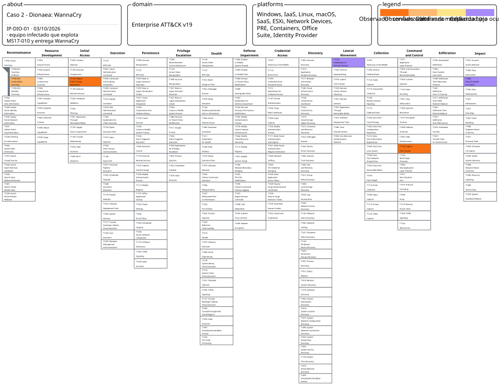
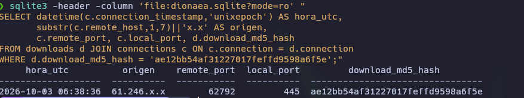
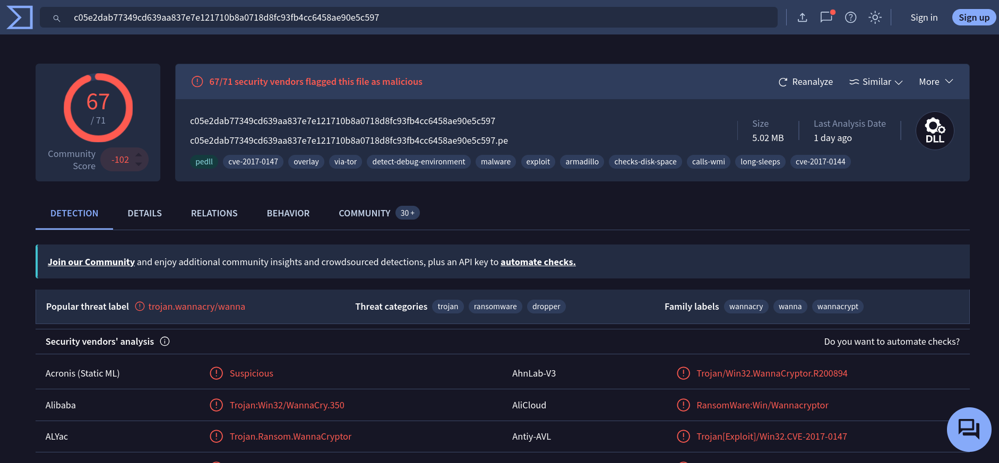
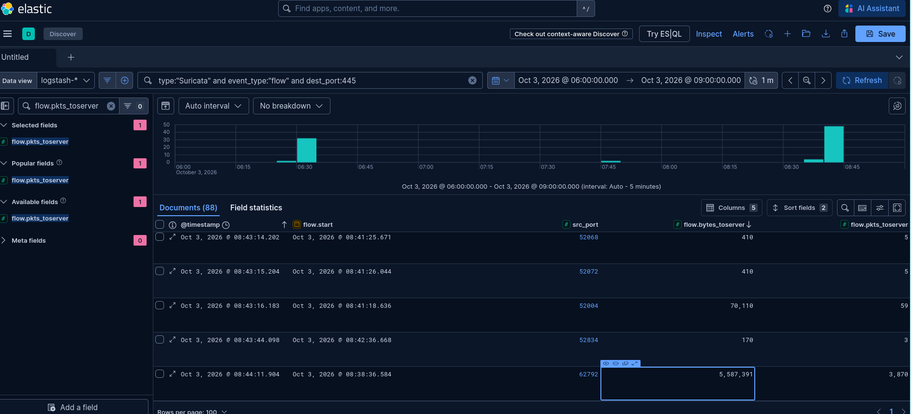
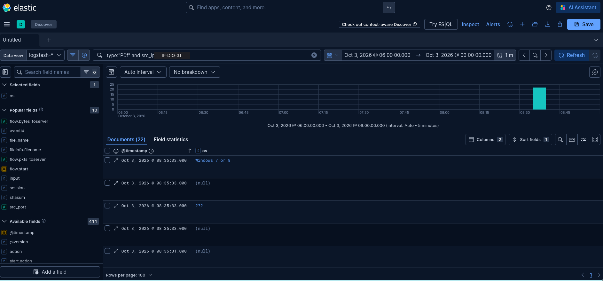
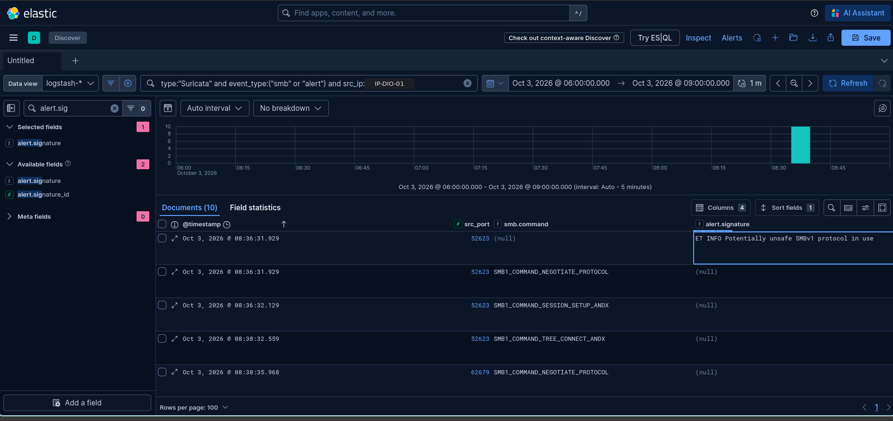

# Caso de estudio 2 – Dionaea: WannaCry sigue propagándose en 2026

> **TL;DR:** un Windows 7/8 infectado por WannaCry comprueba que el honeypot se puede comunicar por SMBv1, explota MS17-010 (EternalBlue) y entrega la DLL del ransomware: 5 conexiones, 8 minutos y 5,59 MB. La IP no aparece en Elastic: se encontró en la base de datos SQLite de Dionaea.

|              |                                                                                                                     |
| ------------ | ------------------------------------------------------------------------------------------------------------------- |
| IP analizada | `IP-DIO-01` (61.246.x.x)                                                                                            |
| Fecha        | 03/10/2026, 06:35–06:43 UTC                                                                                         |
| Técnicas     | 3 observadas + 2 capacidad (DIO-01 a DIO-05)                                                                        |
| Muestra      | SHA-256 `c05e2dab77349cd639aa837e7e121710b8a0718d8fc93fb4cc6458ae90e5c597` · MD5 `ae12bb54af31227017feffd9598a6f5e` |

## Mapa en ATT&CK Navigator



[Abrir la capa interactiva](https://mitre-attack.github.io/attack-navigator/#layerURL=https%3A%2F%2Fraw.githubusercontent.com%2FDanielFadrique%2Fwannacry-still-alive%2Fmain%2Fnavigator%2Fcaso-dionaea.json) · [JSON de la capa](../navigator/caso-dionaea.json)

Colores: naranja oscuro = observado con confianza alta · naranja claro = media · amarillo = baja · morado = capacidad (no ocurrió). Al pasar el ratón por cada técnica se ve su ficha.

## Investigación, en preguntas

**¿Qué IP entregó la muestra de WannaCry?**
El hash no aparece en Elastic ni en el JSON de Dionaea. Las pistas que se siguieron, en orden:

1. Las IPs más activas del 445 (11.048 y ~3.150 eventos) parecían las candidatas. Al analizarlas en Suricata resultaron ser **otra campaña** (una herramienta de EternalBlue en Python con huella de impacket) que **nunca entregó nada**.
2. La relación fichero → conexión está en `dionaea.sqlite`:
```sql
SELECT datetime(c.connection_timestamp, 'unixepoch') AS hora_utc,
       c.remote_host, c.remote_port, d.download_md5_hash
FROM downloads d
JOIN connections c ON c.connection = d.connection
ORDER BY c.connection_timestamp;
```
→ El MD5 de WannaCry aparece una sola vez, en la conexión de IP-DIO-01 (IP censurada en la captura).





**¿Lo confirma otra fuente?**
```
type:"Suricata" and event_type:"flow" and src_ip:"<IP-DIO-01>" and dest_port:445
```
→ La conexión con el mismo puerto de origen envió 5.587.391 bytes.



**¿Desde qué sistema?**
```
type:"P0f" and client_ip:"<IP-DIO-01>"
```
→ Windows 7 u 8.



**¿Lo detectó Suricata como exploit?**
```
type:"Suricata" and src_ip:"<IP-DIO-01>" and event_type:"alert"
```
→ Solo `ET INFO Potentially unsafe SMBv1 protocol in use`. Ninguna firma de exploit.




## Contexto

**Matriz:** Enterprise. Dionaea emula servicios de Windows y bases de datos (SMB, MSSQL, MySQL, FTP, HTTP…), así que el mapeo es directo, sin aproximaciones.

**Contexto de la semana:** 64.801 eventos (78 % de todos los eventos de los honeypots) desde 158 IPs únicas, sobre todo contra `smbd` (445) y `mssqld` (1433). Dionaea capturó una DLL con SHA-256 `c05e2dab77349cd639aa837e7e121710b8a0718d8fc93fb4cc6458ae90e5c597` (MD5 `ae12bb54af31227017feffd9598a6f5e`), identificada como **WannaCry** en VirusTotal (67/71, etiquetas CVE-2017-0144 y CVE-2017-0147).

**Campaña analizada:** un **equipo Windows infectado por WannaCry** que, como gusano, ataca el SMB del honeypot: comprueba que habla SMBv1, explota MS17-010 (EternalBlue) y entrega la DLL de WannaCry. Todo en 5 conexiones y 8 minutos.

## Cómo se encontró la IP

La captura no aparece en Elastic ni en el JSON de Dionaea, que solo registran conexiones. El enlace entre el fichero y la conexión que lo entregó está en la base de datos **`dionaea.sqlite`**: la tabla `downloads` guarda el MD5 de cada captura y el identificador de su conexión, y la tabla `connections` la IP de origen.

```sql
SELECT datetime(c.connection_timestamp, 'unixepoch') AS hora_utc,
       c.remote_host, c.remote_port, c.local_port, d.download_md5_hash
FROM downloads d
JOIN connections c ON c.connection = d.connection
ORDER BY c.connection_timestamp;
```

Se ejecutó sobre la base actual y sus 8 rotaciones (`dionaea.sqlite.N.gz`, descomprimidas en una carpeta temporal y abiertas en solo lectura). El MD5 de WannaCry aparece **una sola vez**, en la conexión 3198. Después se confirmó con Suricata (misma IP y puerto de origen) y con P0f.

## Actividad de IP-DIO-01

| Dato                    | Valor                                                              |
| ----------------------- | ------------------------------------------------------------------ |
| Fecha                   | 03/10/2026, de 06:35:33 a 06:43:06 UTC (unos 8 minutos)            |
| Protocolo               | SMB, TCP/445                                                       |
| Conexiones (Dionaea)    | 5                                                                  |
| Eventos en Suricata     | 15: 5 `flow`, 9 `smb`, 1 `alert`                                   |
| Alertas                 | Solo `ET INFO Potentially unsafe SMBv1 protocol in use`.           |
| Sistema de origen (P0f) | **Windows 7 u 8**, a 8 saltos de distancia                         |
| Fichero capturado       | MD5 `ae12bb54af31227017feffd9598a6f5e` = WannaCry (VirusTotal)     |
| Bytes de la entrega     | **5.587.391** enviados al honeypot en 4,5 minutos (3.870 paquetes) |

**Atribución de la muestra: confianza Alta.** Encajan cuatro pruebas independientes:

| Prueba | Fuente | Resultado |
|---|---|---|
| Fichero → conexión | `dionaea.sqlite` | MD5 de WannaCry guardado desde la conexión 3198 (IP-DIO-01, puerto 62792) |
| Tamaño | Suricata `flow` | La conexión con ese mismo puerto envió 5,59 MB |
| Herramienta | Suricata `smb` | Lista de dialectos SMB1 antigua, típica de EternalBlue; sin la huella `Unix/Samba` de impacket |
| Sistema | P0f | Windows 7 u 8, coherente con un equipo infectado sin parchear |

## Cronología de la sesión

| Nº | Hora UTC | Conexión (puerto origen) | Evento | Qué busca el atacante | Mapeo |
|---|---|---|---|---|---|
| 1 | 06:35:33 | 50267 | Conexión TCP al 445 sin SMB (228 bytes). P0f: Windows 7/8 | ¿Está el 445 abierto? | DIO-01 · T1595.002 |
| 2 | 06:36:31 | 52615 | Segundo sondeo idéntico (228 bytes) | Confirmar el puerto | DIO-01 · T1595.002 |
| 3 | 06:36:31 → 06:38:32 | 52623 | Negociación SMB1 (`LANMAN1.0` … `NT LM 0.12`), sesión anónima y conexión a `IPC$`. Salta `ET INFO … SMBv1` | ¿Acepta SMBv1 y sesiones anónimas? | DIO-01 · T1595.002 |
| 4 | 06:38:35 | 62679 | Negociación con la lista de dialectos antigua (`PC NETWORK PROGRAM 1.0` … `NT LM 0.12`), sesión anónima e `IPC$` (899 bytes, 1,2 s) | Preparar la explotación de MS17-010 | DIO-02 · T1190 |
| 5 | 06:38:36 | 62792 | Misma preparación y explotación | Explotar MS17-010 | DIO-02 · T1190 |
| 5 | 06:38:36 → 06:43:06 | 62792 | **5.587.391 bytes** enviados; Dionaea guarda la DLL de WannaCry | Entregar la carga | DIO-03 · T1105 |
| — | — | — | Cifrado de ficheros y propagación a otros equipos | Objetivo de la muestra | DIO-04 · T1486, DIO-05 · T1210 (Capacidad) |

**Lectura de la secuencia:** comprueba, prepara y entrega. Son solo 5 conexiones, frente a las miles de la herramienta de impacket que atacó el mismo puerto durante la semana (ver contexto). Es el patrón de un gusano: ataca un objetivo concreto, entrega la carga y pasa al siguiente.

**Observación:** en la conexión 3, la ruta del recurso es `\\10.8.3.153\IPC$`, una **dirección privada** que no es la del honeypot. Puede indicar que el equipo infectado está en una red interna detrás de NAT o que la herramienta usa una dirección fija. _Hipótesis, de confianza Baja._

# Técnicas encontradas en la campaña

## DIO-01 · T1595.002 Vulnerability Scanning

| Campo                 | Valor                                                                                               |
| --------------------- | --------------------------------------------------------------------------------------------------- |
| Táctica               | Reconnaissance                                                                                      |
| Técnica               | [T1595.002 Active Scanning: Vulnerability Scanning](https://attack.mitre.org/techniques/T1595/002/) |
| Eventos               | 2 conexiones TCP sin SMB + 1 conexión con negociación SMB1, sesión anónima y `IPC$`                 |
| Posición en la sesión | Conexiones 1-3, de 06:35:33 a 06:38:32                                                              |
| Recuento              | 3 conexiones en IP-DIO-01                                                                           |
| Evidencia             | [EV-DIO-04](../img/evidencias/EV-DIO-04.png)                                                        |
| Status                | Observado                                                                                           |
| Confianza             | Media                                                                                               |

**Qué hace:** primero comprueba dos veces que el 445 responde. Después abre una conexión SMB1, inicia una sesión anónima y se conecta al recurso `IPC$`. Es la comprobación previa que hace WannaCry para saber si el objetivo habla en SMBv1 y admite sesiones anónimas, condiciones necesarias para explotar MS17-010.

**Por qué este mapeo:** comprobar si un servicio expuesto es vulnerable antes de atacarlo es T1595.002. La confianza es **Media** porque Suricata no registra la respuesta concreta que el gusano usa para decidir que el objetivo es vulnerable; la intención se deduce de la secuencia y de lo que ocurre justo después.

**Consulta KQL:**
```
type:"Suricata" and src_ip:"<IP-DIO-01>" and event_type:"smb"
```

## DIO-02 · T1190 Exploit Public-Facing Application

| Campo | Valor |
|---|---|
| Táctica | Initial Access |
| Técnica | [T1190 Exploit Public-Facing Application](https://attack.mitre.org/techniques/T1190/) |
| Vulnerabilidad | MS17-010 (CVE-2017-0144 / CVE-2017-0147), SMBv1 |
| Eventos | Conexiones 4 y 5: negociación SMB1 con la lista de dialectos antigua, sesión anónima e `IPC$`, seguida de la entrega de la carga |
| Posición en la sesión | 06:38:35 – 06:38:36 |
| Recuento | 2 conexiones en IP-DIO-01 |
| Evidencia | [EV-DIO-04](../img/evidencias/EV-DIO-04.png) · [EV-DIO-05](../img/evidencias/EV-DIO-05.png) |
| Status | Observado |
| Confianza | Alta |

**Qué hace:** usa la vulnerabilidad de SMBv1 conocida como EternalBlue para conseguir ejecución en el sistema sin credenciales. Dionaea emula la vulnerabilidad y acepta la carga, que es justo lo que permite capturarla.

**Por qué este mapeo:** se explota un servicio expuesto directamente a Internet, que desde el punto de vista del honeypot es T1190. La confianza es **Alta** porque la explotación termina con la entrega de una muestra de WannaCry, cuya familia y CVE confirma VirusTotal. Se usa T1190 y no T1210 porque el ataque llega desde Internet a un servicio público; T1210 describe el mismo exploit usado dentro de una red y se reserva para la capacidad de propagación (DIO-05).

**Lo que no se observa:** ninguna firma de exploit de Suricata saltó en estas conexiones, solo la `ET INFO` de SMBv1 (ver notas).

**Consulta KQL:**
```
type:"Suricata" and src_ip:"<IP-DIO-01>" and event_type:("smb" or "alert")
```

## DIO-03 · T1105 Ingress Tool Transfer

| Campo | Valor |
|---|---|
| Táctica | Command and Control |
| Técnica | [T1105 Ingress Tool Transfer](https://attack.mitre.org/techniques/T1105/) |
| Evento | Fila de `downloads` en `dionaea.sqlite` (conexión 3198) + `flow` de Suricata (puerto 62792) |
| Posición en la sesión | Conexión 5, de 06:38:36 a 06:43:06 |
| Recuento | 1 entrega en IP-DIO-01 |
| Evidencia | [EV-DIO-01](../img/evidencias/EV-DIO-01.png) · [EV-DIO-02](../img/evidencias/EV-DIO-02.png) |
| Status | Observado |
| Confianza | Alta |

**Qué ocurre:** tras la explotación, el atacante envía **5.587.391 bytes** por la misma conexión SMB durante 4,5 minutos. Dionaea reconstruye la carga y la guarda como fichero: la DLL de WannaCry (MD5 `ae12bb54…`, SHA-256 `c05e2dab…`).

**Por qué este mapeo:** es la transferencia de una herramienta maliciosa desde el exterior al sistema comprometido, registrada con hash y vinculada a su conexión de origen. Confianza **Alta**.

**Detalle a destacar:** no hay servidor de descarga. La carga viaja dentro de la propia conexión del exploit, como en todo gusano: cada equipo infectado lleva una copia y la entrega al siguiente.

**Consulta KQL:**
```
type:"Suricata" and event_type:"flow" and src_ip:"<IP-DIO-01>" and dest_port:445
```

## DIO-04 · T1486 Data Encrypted for Impact

| Campo | Valor |
|---|---|
| Táctica | Impact |
| Técnica | [T1486 Data Encrypted for Impact](https://attack.mitre.org/techniques/T1486/) |
| Evidencia | [EV-DIO-05](../img/evidencias/EV-DIO-05.png): VirusTotal identifica la muestra como WannaCry (67/71) |
| Status | Capacidad |
| Confianza | Alta |

**Qué se sabe:** WannaCry es un ransomware: en un equipo real cifra los ficheros y pide un rescate.

**Por qué este status:** Dionaea no ejecuta lo que captura, así que el cifrado **no ocurre** en el honeypot. Es una capacidad de la muestra, con confianza Alta en que la tiene porque la familia está confirmada.

## DIO-05 · T1210 Exploitation of Remote Services

| Campo | Valor |
|---|---|
| Táctica | Lateral Movement |
| Técnica | [T1210 Exploitation of Remote Services](https://attack.mitre.org/techniques/T1210/) |
| Evidencia | [EV-DIO-05](../img/evidencias/EV-DIO-05.png) (familia WannaCry, gusano por MS17-010) · [EV-DIO-03](../img/evidencias/EV-DIO-03.png) (el origen es un Windows 7/8, no una herramienta) |
| Status | Capacidad |
| Confianza | Media |

**Qué se sabe:** WannaCry se propaga solo, explotando MS17-010 en otros equipos de la red local y de Internet. IP-DIO-01 es, muy probablemente, una víctima haciendo exactamente eso.

**Por qué este status:** la propagación desde el honeypot no ocurre, porque Dionaea no ejecuta la muestra. La confianza es **Media** porque que IP-DIO-01 sea una víctima y no el operador es una deducción (P0f, patrón de gusano, ausencia de servidor de descarga), no una prueba.

## Lo que no se mapea en Dionaea

- **T1210 para la explotación observada:** el ataque llega desde Internet a un servicio público, así que se mapea como T1190 (DIO-02). T1210 se reserva para la propagación (DIO-05).
- **Otras capacidades conocidas de WannaCry** (por ejemplo, borrar las copias de seguridad del sistema): la muestra no se ejecutó, así que solo se recogen como Capacidad las dos que definen la familia, el cifrado y la propagación.
- **Las otras campañas de Dionaea** (herramienta de EternalBlue con huella de impacket y fuerza bruta contra MSSQL): se documentan como contexto más abajo, pero no forman parte del caso.

## Contexto: otras entregas de ~5,6 MB en la semana

La tabla `downloads` registra **siete entregas de entre 5,59 y 5,81 MB** desde siete IPs distintas, todas con el mismo patrón de pocas conexiones y sin la huella de impacket. Tres de ellas, incluida la de IP-DIO-01, enviaron **exactamente 5.587.391 bytes**.

| Fecha UTC | IP (truncada) | Bytes |
|---|---|---|
| 26/09 12:08 | 154.242.x.x | 5.587.387 |
| 27/09 02:46 | 116.109.x.x | 5.596.401 |
| 27/09 21:03 | 103.18.x.x | 5.587.391 |
| 28/09 12:41 | 14.162.x.x | 5.620.249 |
| 29/09 12:03 | 41.113.x.x | 5.808.061 |
| 30/09 10:30 | 14.248.x.x | 5.587.391 |
| **03/10 06:38** | **IP-DIO-01** | **5.587.391 (WannaCry confirmado)** |

_Hipótesis, confianza Media:_ son otros equipos infectados por WannaCry propagando el gusano. Solo la muestra de IP-DIO-01 está confirmada; las demás no se han analizado.

## Contexto: otras campañas en Dionaea (no mapeadas)

| Alias | Servicio | Comportamiento | Resultado |
|---|---|---|---|
| IP-DIO-02, IP-DIO-03 | SMB (445) | Herramienta de EternalBlue en Python con huella de impacket (`Unix/Samba`): 2 intentos de 70 KB y un bucle de miles de negociaciones SMB (11.048 y 3.161 conexiones) | Sin entrega de carga. Forman parte de las 8 IPs con huella de impacket de la semana (una de 11.048 conexiones y siete de ~3.150, ver [resumen de datos](02-resumen-datos.md)) |
| IP-DIO-04 | MSSQL (1433) | Fuerza bruta con `sa` y `admin` en dos pasadas (500 y 1.928 contraseñas), con diccionario actualizado a 2026 | Ningún login correcto |

Se documentan como contexto: muestran que el mismo puerto recibe herramientas muy distintas, y que **el volumen no indica peligrosidad**. La campaña que sí entregó malware es la de menos conexiones.

## Notas de Dionaea

- **Metodología:** en T-Pot, las capturas de Dionaea no llegan a Elastic ni al JSON. Para atribuirlas hay que consultar `dionaea.sqlite` (tablas `downloads` y `connections`) y cruzar con Suricata por IP y puerto de origen.
- **Lección aprendida (detección):** Suricata no generó ninguna firma de exploit de MS17-010 en la entrega de WannaCry, solo la alerta informativa de SMBv1. Revisar si las reglas `ET EXPLOIT` de MS17-010 están activas en el contenedor de Suricata o si dependen de respuestas que Dionaea no emula.
- **Privacidad:** en los eventos de Suricata, `dest_ip` y las rutas `\\<IP>\IPC$` pueden contener la IP pública del VPS. En las capturas publicadas está tapada.

## Qué no se puede afirmar

- **Que el cifrado o la propagación ocurrieran:** Dionaea no ejecuta lo que captura (DIO-04 y DIO-05 son capacidad).
- **Que IP-DIO-01 sea el autor del ataque:** todo apunta a una víctima infectada que propaga el gusano (hipótesis).
- **Que las otras seis entregas de ~5,6 MB sean WannaCry:** solo coinciden en tamaño y patrón; no se han analizado.

## Detección y respuesta

- **Prevención:** aplicar el parche MS17-010, desactivar SMBv1 y no exponer el 445 a Internet.
- **Detección:** negociaciones SMB1 desde Internet; sesiones anónimas con conexión a `IPC$`; flujos SMB entrantes de varios MB. Revisar por qué las firmas de MS17-010 no saltaron (ver [lecciones](08-lecciones.md)).
- **Respuesta (L1):** si el origen es interno, aislar el equipo de inmediato (WannaCry se propaga solo), buscar el servicio y los ficheros de WannaCry y escalar como incidente de ransomware.


---

[← Volver al README](../README.md) · [Mapeo MITRE](06-mapeo-mitre.md)
