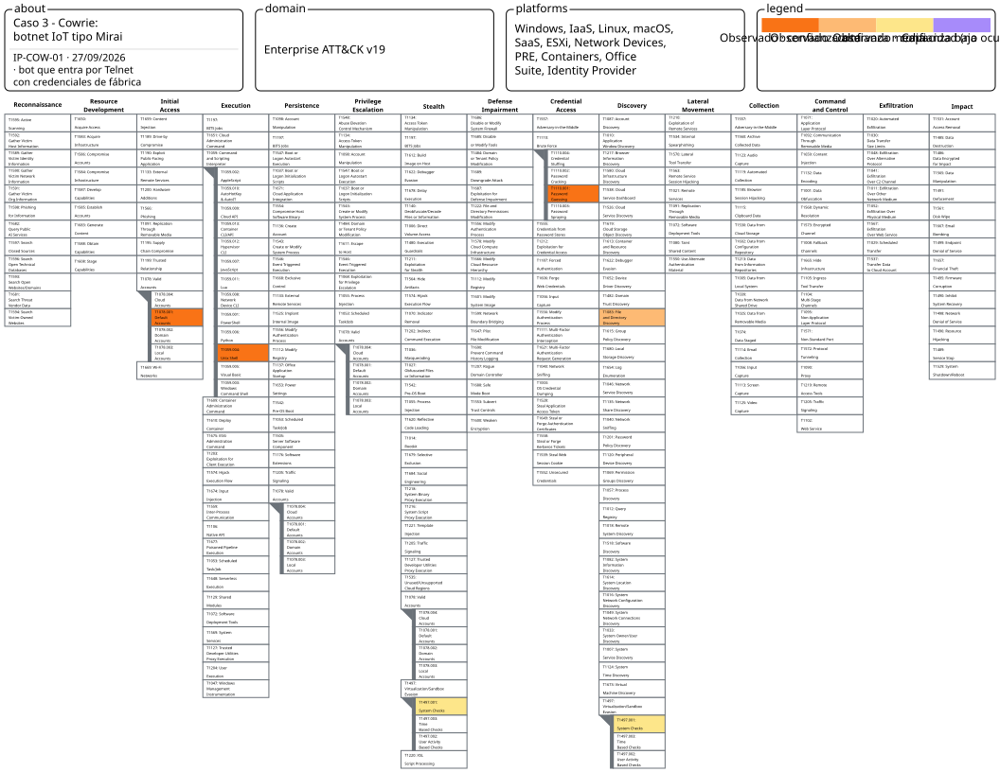
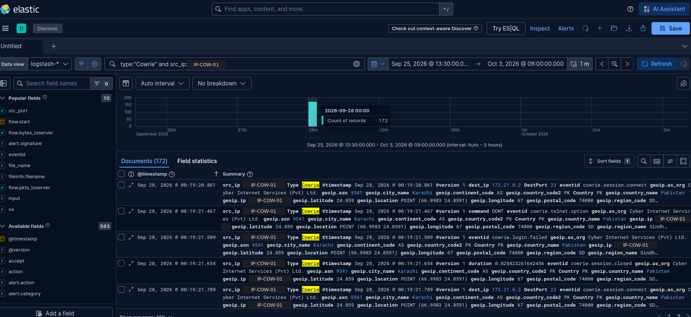
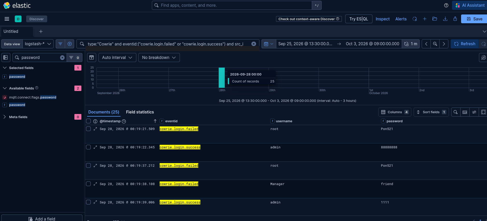
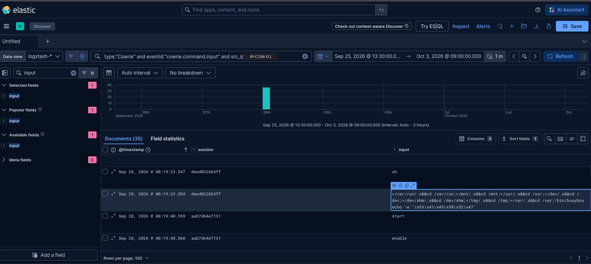
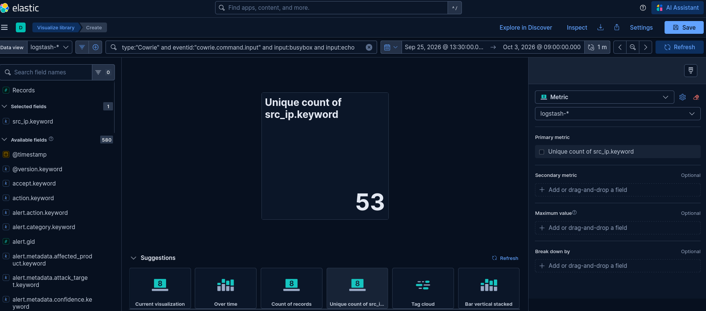

# Caso de estudio 3 – Cowrie: bot de una botnet IoT tipo Mirai por Telnet

> **TL;DR:** en 76 segundos, un bot prueba credenciales de fábrica de routers y ONT de fibra, entra cuatro veces, intenta salir de la consola del router, busca una carpeta con escritura y comprueba con BusyBox si el dispositivo es real. Cowrie no supera la prueba y el bot se va sin descargar nada.

| | |
|---|---|
| IP analizada | `IP-COW-01` (153.117.x.x) |
| Fecha | 27/09/2026, 22:19–22:20 UTC |
| Técnicas | 5 observadas (COW-01 a COW-05) |

## Mapa en ATT&CK Navigator



[Abrir la capa interactiva](https://mitre-attack.github.io/attack-navigator/#layerURL=https%3A%2F%2Fraw.githubusercontent.com%2FDanielFadrique%2Fwannacry-still-alive%2Fmain%2Fnavigator%2Fcaso-cowrie.json) · [JSON de la capa](../navigator/caso-cowrie.json)

Colores: naranja oscuro = observado con confianza alta · naranja claro = media · amarillo = baja · morado = capacidad (no ocurrió). Al pasar el ratón por cada técnica se ve su ficha. T1497.001 aparece dos veces en la capa porque en ATT&CK v19 pertenece a dos tácticas, Stealth y Discovery: son 5 técnicas en 6 casillas.

## Investigación, en preguntas

**¿Qué hizo esta IP y durante cuánto tiempo?**
```
type:"Cowrie" and src_ip:"<IP-COW-01>"
```
→ 172 eventos en 76 segundos, 25 sesiones.



**¿Consiguió entrar? ¿Con qué credenciales?**
```
type:"Cowrie" and src_ip:"<IP-COW-01>" and eventid:("cowrie.login.failed" or "cowrie.login.success")
```
→ 21 fallos y 4 accesos con credenciales de fábrica (`gpon/gpon`, `Admin/Admin`…).



**¿Qué ejecutó tras entrar?**
```
type:"Cowrie" and src_ip:"<IP-COW-01>" and eventid:"cowrie.command.input"
```
→ Escape de la consola del router, búsqueda de carpeta con escritura y `busybox echo` con el marcador `SAEXRG`.



**¿Es un caso aislado o una botnet más amplia?**
```
type:"Cowrie" and eventid:"cowrie.command.input" and input:busybox and input:echo
```
→ **53 IPs** lanzan exactamente la misma secuencia (escape de consola, búsqueda de carpeta y `busybox echo`) en 80 sesiones. Solo cambia la palabra que imprime BusyBox: cada bot genera la suya al azar.




## Contexto

**Matriz:** Enterprise. Cowrie emula un servidor Linux con SSH y Telnet, así que el mapeo es directo, sin aproximaciones.

**Contexto de la semana:** 7.129 eventos desde 352 IPs únicas, mayoritariamente por **Telnet**, con credenciales típicas de routers e IoT.

**Campaña analizada:** bot de una **botnet IoT tipo Mirai** que entra por Telnet con credenciales de fábrica de routers y ONT de fibra, intenta conseguir una shell, busca una carpeta con permiso de escritura y comprueba con BusyBox si el dispositivo es real. Cowrie no supera esa comprobación, así que el bot abandona antes de descargar nada.

## Actividad de IP-COW-01

| Dato | Valor |
|---|---|
| Fecha | 27/09/2026, de 22:19:20 a 22:20:36 UTC (**76 segundos**) |
| Protocolo | Telnet, TCP/23 |
| Eventos en el log en bruto | 172: 25 conexiones, 25 negociaciones Telnet, 21 logins fallidos, 4 logins correctos, 36 comandos (28 rechazados por Cowrie), 25 cierres |
| Sesiones | 25, **una por cada credencial probada** |
| Credenciales con éxito | `admin/88888888`, `admin/1111`, `Admin/Admin`, `gpon/gpon` |
| Comandos | El mismo bloque de 9 comandos en cada una de las 4 sesiones con éxito |
| Descargas | Ninguna |
| Grabaciones | 4 grabaciones TTY de Cowrie (`cowrie.log.closed`), reproducibles con `playlog` |

**Ritmo:** una conexión nueva cada 0,9 segundos. Las sesiones fallidas duran unos 0,7 s; las que entran, unos 14 s. Tras cada éxito, el bot vuelve a la lista de credenciales como si nada: no guarda que ya ha entrado.

**Diccionario:** credenciales de fábrica de equipos de red concretos, no una lista genérica:

| Credencial | Equipo al que apunta |
|---|---|
| `gpon/gpon`, `admin/gpon` | ONT de fibra GPON |
| `draytek/1234` | Routers DrayTek |
| `cuadmin/cu@Hnunicom` | Routers de China Unicom |
| `root/Pon521`, `root/GM8182`, `admin/v2mprt`, `admin/smcadmin` | Firmwares de fabricantes de equipos de red |
| `root/` (vacía), `root/666666`, `admin/12345678`, `Admin/Admin` | Valores por defecto genéricos de IoT |

## Cronología de la sesión

Primera sesión con éxito (`deed0226b3ff`). Las otras tres sesiones con éxito son idénticas.

| Nº | Hora UTC | Comando o evento | Qué busca el bot | Mapeo |
|---|---|---|---|---|
| — | 22:19:20 | Login fallido `root/Pon521` (sesión anterior) | Adivinar credenciales de fábrica | COW-01 · T1110.001 |
| — | 22:19:21 | Conexión Telnet y login correcto `admin/88888888` | Entrar con una cuenta por defecto | COW-02 · T1078.001 |
| 1-8 | 22:19:23 | `start`, `enable`, `config terminal`, `system`, `linuxshell`, `su`, `shell`, `sh` | Escapar de la consola limitada del router y conseguir una shell de Linux | COW-03 · T1059.004 |
| 9a | 22:19:23 | `>/var/run/.x&&cd /var/run;>/mnt/.x&&cd /mnt;…>/tmp/.x&&cd /tmp;>/var/.x&&cd /var` | Encontrar una carpeta con permiso de escritura | COW-04 · T1083 |
| 9b | 22:19:23 | `/bin/busybox echo -e '\x53\x41\x45\x58\x52\x47'` (`SAEXRG`) | Comprobar que la shell es real antes de descargar el malware | COW-05 · T1497.001 |
| — | 22:19:36 | Cierre de sesión (14,8 s) | Abandono tras esperar 13 s una respuesta `SAEXRG` que no llega | — |
| — | 22:19:36 → 22:20:36 | 20 logins más (3 con éxito, mismo bloque de comandos) | Seguir recorriendo el diccionario | COW-01, COW-02 |

Los 9 comandos llegan en **28 milisegundos**: el bot los envía todos de golpe, sin esperar respuesta a ninguno, lo que confirma un script automatizado. Después espera unos 13 segundos la respuesta `SAEXRG` y, al no recibirla, cierra. Los comandos 9a y 9b llegan en una sola línea, que Cowrie registra como un único `command.input`.

# Técnicas encontradas en la campaña

## COW-01 · T1110.001 Password Guessing

| Campo | Valor |
|---|---|
| Táctica | Credential Access |
| Técnica | [T1110.001 Brute Force: Password Guessing](https://attack.mitre.org/techniques/T1110/001/) |
| Evento | `cowrie.login.failed` |
| Posición en la sesión | Durante los 76 segundos, intercalado con los logins correctos |
| Recuento | 21 intentos fallidos en IP-COW-01 (25 en total, contando los 4 correctos) · 1.086 logins fallidos en la semana, desde 63 IPs |
| Evidencia | [EV-COW-02](../img/evidencias/EV-COW-02.png) |
| Status | Observado |
| Confianza | Alta |

**Qué hace:** el bot abre una conexión Telnet, prueba **una sola** pareja de usuario y contraseña, y si falla cierra y abre otra. Así recorre una lista de credenciales de fábrica de routers y dispositivos IoT a razón de una por segundo.

**Por qué este mapeo:** probar una lista de contraseñas contra un servicio hasta acertar es fuerza bruta de diccionario. No es T1110.003 Password Spraying (pocas contraseñas contra muchos usuarios) ni T1110.004 Credential Stuffing (credenciales robadas de una filtración): la lista es de **valores por defecto de fabricantes**.

**Consulta KQL:**
```
type:"Cowrie" and eventid:"cowrie.login.failed"
```

## COW-02 · T1078.001 Default Accounts

| Campo | Valor |
|---|---|
| Táctica | Initial Access |
| Técnica | [T1078.001 Valid Accounts: Default Accounts](https://attack.mitre.org/techniques/T1078/001/) |
| Evento | `cowrie.login.success` |
| Posición en la sesión | 4 veces: 22:19:21, 22:19:38, 22:19:54 y 22:20:14 |
| Recuento | 4 en IP-COW-01 · 83 logins correctos en la semana, desde 56 IPs |
| Evidencia | [EV-COW-02](../img/evidencias/EV-COW-02.png) |
| Status | Observado |
| Confianza | Alta |

**Qué hace:** el bot consigue entrar con credenciales de fábrica: `admin/88888888`, `admin/1111`, `Admin/Admin` y `gpon/gpon`.

**Por qué este mapeo:** acceder con cuentas que vienen configuradas por defecto en los dispositivos es exactamente T1078.001. Se usa esta técnica como acceso inicial en lugar de T1133 External Remote Services porque aquí la entrada depende de las credenciales, y T1078.001 lo describe con más precisión.

**Matiz:** Cowrie está configurado para aceptar muchas credenciales, así que un login correcto significa que **el honeypot dejó pasar** esa pareja, no que sea más válida que las que fallaron. Lo observado es que el atacante usa credenciales por defecto y que, cuando entra, sigue con la intrusión.

**Consulta KQL:**
```
type:"Cowrie" and eventid:"cowrie.login.success"
```

## COW-03 · T1059.004 Unix Shell

| Campo | Valor |
|---|---|
| Táctica | Execution |
| Técnica | [T1059.004 Command and Scripting Interpreter: Unix Shell](https://attack.mitre.org/techniques/T1059/004/) |
| Comandos | `start`, `enable`, `config terminal`, `system`, `linuxshell`, `su`, `shell`, `sh` y la línea de los comandos 9a-9b |
| Posición en la sesión | Inmediatamente después de cada login correcto; los 9 comandos llegan en 28 ms |
| Recuento | 9 comandos × 4 sesiones = 36 en IP-COW-01 · La misma secuencia en 80 sesiones de 53 IPs en la semana |
| Evidencia | [EV-COW-03](../img/evidencias/EV-COW-03.png) |
| Status | Observado |
| Confianza | Alta |

**Qué hace:** muchos routers no dan una shell de Linux al entrar, sino una consola de configuración propia. El bot lanza a ciegas las palabras con las que distintos fabricantes permiten salir de esa consola (`enable`, `system`, `linuxshell`, `shell`, `sh`…) porque no sabe qué marca hay al otro lado. Cowrie rechazó casi todas como "command not found", pero aceptó `su` y `sh`. Después ejecuta comandos de shell.

**Por qué este mapeo:** el objetivo de la secuencia es obtener un intérprete de comandos de Unix y ejecutar órdenes en él, que es T1059.004.

**Lo que no se mapea:** `enable` y `su` son intentos de escapar de la consola, no una escalada de privilegios que se pueda probar, así que no se mapean como Privilege Escalation.

**Consulta KQL:**
```
type:"Cowrie" and eventid:"cowrie.command.input" and input:("enable" or "linuxshell" or "shell")
```

## COW-04 · T1083 File and Directory Discovery

| Campo | Valor |
|---|---|
| Táctica | Discovery |
| Técnica | [T1083 File and Directory Discovery](https://attack.mitre.org/techniques/T1083/) |
| Comando | `>/var/run/.x&&cd /var/run;>/mnt/.x&&cd /mnt;>/usr/.x&&cd /usr;>/dev/.x&&cd /dev;>/dev/shm/.x&&cd /dev/shm;>/tmp/.x&&cd /tmp;>/var/.x&&cd /var` |
| Posición en la sesión | Comando 9, primera parte, justo después de conseguir la shell |
| Recuento | 4 en IP-COW-01 (1 por sesión con éxito) |
| Evidencia | [EV-COW-03](../img/evidencias/EV-COW-03.png) |
| Status | Observado |
| Confianza | Media |

**Qué hace:** en cada carpeta candidata intenta crear un fichero vacío `.x` (`>/ruta/.x`). Si lo consigue, entra en ella (`&& cd /ruta`). Al terminar, el bot queda situado en la última carpeta con permiso de escritura, que es donde descargaría su binario. En los routers gran parte del sistema es de solo lectura, por eso prueba tantas rutas.

**Por qué este mapeo:** el bot explora el sistema de ficheros para encontrar una ubicación útil, que encaja con T1083. La confianza es **Media** porque no lista ficheros ni carpetas: comprueba permisos de escritura creando ficheros, una variante menos típica de la técnica.

**Consulta KQL:**
```
type:"Cowrie" and input:*\/dev\/shm\/.x*
```

## COW-05 · T1497.001 System Checks

| Campo | Valor |
|---|---|
| Táctica | Stealth · Discovery |
| Técnica | [T1497.001 Virtualization/Sandbox Evasion: System Checks](https://attack.mitre.org/techniques/T1497/001/) |
| Comando | `/bin/busybox echo -e '\x53\x41\x45\x58\x52\x47'` |
| Posición en la sesión | Comando 9, segunda parte; último comando antes de abandonar |
| Recuento | 4 en IP-COW-01 (1 por sesión con éxito) |
| Evidencia | [EV-COW-03](../img/evidencias/EV-COW-03.png) · [EV-COW-04](../img/evidencias/EV-COW-04.png) |
| Status | Observado (el comando) · Hipótesis (la intención) |
| Confianza | Baja |

**Qué hace:** los códigos hexadecimales forman el texto **`SAEXRG`**. El bot le pide a BusyBox, las utilidades de Linux de casi todos los routers, que lo imprima. Si recibe `SAEXRG` de vuelta, sabe que tiene una shell real que ejecuta sus comandos y sigue con la descarga del malware. Cowrie respondió que el comando no existía, y el bot cerró la sesión.

**Por qué este mapeo:** comprobar el entorno antes de continuar, y abandonar si no es el esperado, es el comportamiento que describe T1497.001. La confianza es **Baja** porque el propósito principal de esta comprobación en Mirai es confirmar que tiene una shell funcional en un dispositivo con BusyBox. Que además sirva para detectar honeypots es una consecuencia, no necesariamente su intención.

**La palabra es aleatoria, el comando no:** el Mirai original usa siempre `/bin/busybox ECCHI`. Este bot genera una palabra de 6 letras distinta en cada instancia: en la semana aparecen 52 palabras diferentes en 53 IPs, y `SAEXRG` es solo la de IP-COW-01. Lo que identifica a la botnet es la **plantilla del comando** (las mismas carpetas `.x` en el mismo orden y un `busybox echo -e` con 6 bytes en hexadecimal). Esa plantilla es el indicador útil para detectarla.

**Consulta KQL:**
```
type:"Cowrie" and input:*x53\\x41\\x45\\x58\\x52\\x47*
```

## Lo que no se mapea en Cowrie

- **T1105 Ingress Tool Transfer:** no hubo descarga; el bot abandonó antes.
- **T1133 External Remote Services:** el acceso inicial se cubre con T1078.001, que es más específica.
- **Capacidades de Mirai (DDoS, propagación):** no hay muestra que las confirme, así que no se incluyen ni como Capacidad.

## Notas de Cowrie

- **Tamaño de la botnet:** 53 IPs ejecutan la misma secuencia de comandos en 80 sesiones durante la semana, cada una con su palabra aleatoria. IP-COW-01 se analiza como representativa.
- **Lección aprendida:** Cowrie no supera la comprobación de BusyBox de Mirai, así que nunca recibe el binario. Si se quiere capturar el malware, Cowrie puede configurarse para responder a esa prueba.
- **Descargas en Cowrie:** en toda la semana hay 20 eventos `cowrie.session.file_download`, todos desde **una sola IP**. No se conservó ninguna muestra de malware de Cowrie para analizar. IP-COW-01 no descargó nada.

## Qué no se puede afirmar

- **La familia exacta:** se clasifica como tipo Mirai por comportamiento, no por una muestra analizada.
- **Que las credenciales "correctas" sean especiales:** Cowrie acepta muchas credenciales por configuración.
- **Qué habría descargado:** el bot abandona antes de la descarga.

## Detección y respuesta

- **Prevención:** desactivar Telnet, cambiar las credenciales de fábrica y no exponer la administración de routers a Internet.
- **Detección:** varios fallos de login seguidos de un acceso correcto desde la misma IP; comandos `busybox echo` con secuencias hexadecimales; creación de ficheros `.x` en carpetas como `/tmp` o `/dev/shm`.
- **Respuesta (L1):** bloquear la IP, cambiar las credenciales del dispositivo afectado y revisar si hay procesos o binarios nuevos en carpetas temporales.


---

[← Volver al README](../README.md) · [Mapeo MITRE](06-mapeo-mitre.md)
