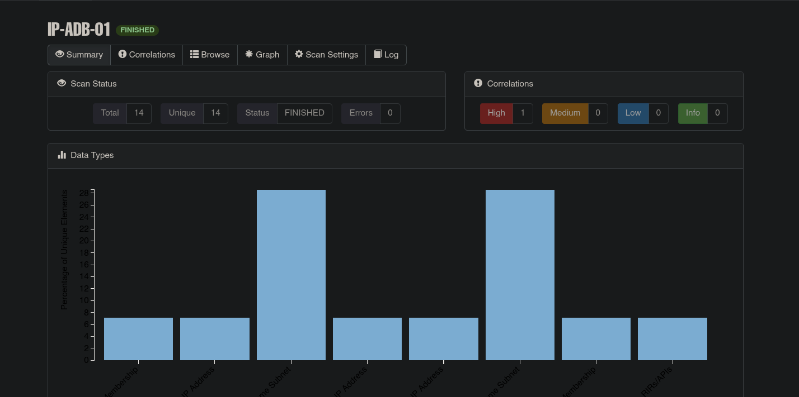
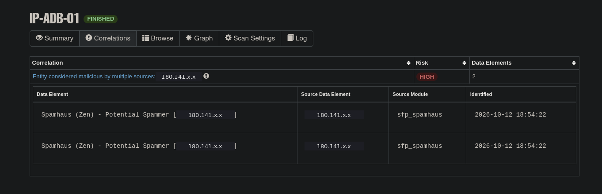
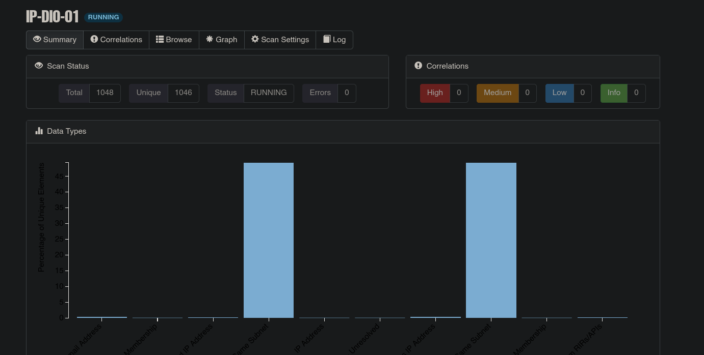
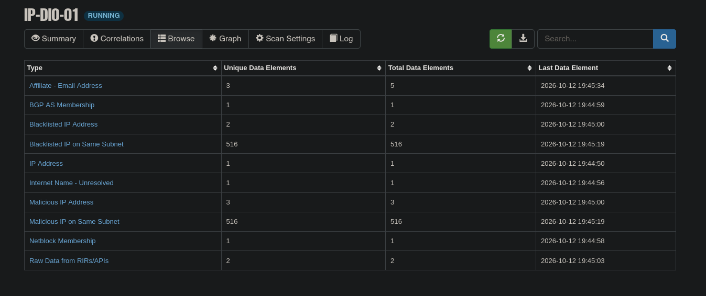
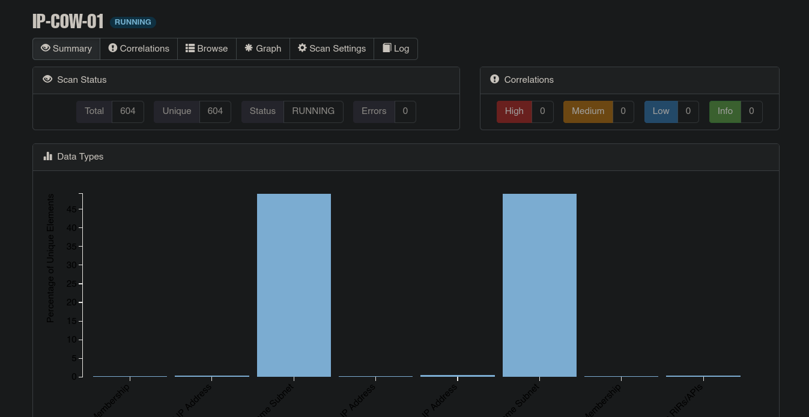
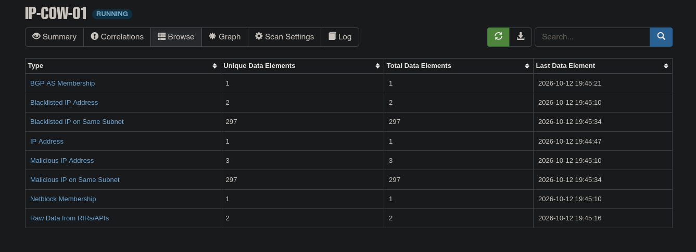

# OSINT pasivo de IPs atacantes

**Pregunta guía:** ¿estas IPs son atacantes o dispositivos infectados?

**Herramienta y reglas:** SpiderFoot, el que incluye T-Pot, solo con módulos **pasivos** (sin escanear ni contactar las IPs). Los escaneos se lanzaron el 12/10/2026, nueve días después del final del experimento, así que la reputación puede incluir actividad posterior a los ataques. Las IPs se publican truncadas y sin datos personales de sus titulares.

## IPs seleccionadas

Las tres IPs analizadas en los casos de estudio:

| Alias | IP | Por qué se eligió | Hipótesis de partida |
|---|---|---|---|
| IP-ADB-01 | 180.141.x.x | Instaló los mineros por ADB (caso 1) | Dispositivo Android o IoT infectado que propaga la campaña |
| IP-DIO-01 | 61.246.x.x | Entregó WannaCry (caso 2) | Windows 7/8 infectado que propaga el gusano |
| IP-COW-01 | 153.117.x.x | Bot tipo Mirai con logins y comandos (caso 3) | Dispositivo IoT infectado (router u ONT) |

## Resultados

| Dato | IP-ADB-01 | IP-DIO-01 | IP-COW-01 |
|---|---|---|---|
| Estado del escaneo en la captura | FINISHED | FINISHED | FINISHED |
| Data elements únicos | 14 | 1.046 | 604 |
| BGP AS Membership · Netblock Membership | 1 · 1 | 1 · 1 | 1 · 1 |
| Blacklisted IP Address | 1 | 2 | 2 |
| Malicious IP Address | 1 | 3 | 3 |
| Blacklisted · Malicious IP on Same Subnet | 4 · 4 | 516 · 516 | 297 · 297 |
| Otros data types | Raw Data from RIRs/APIs (1) | Raw Data from RIRs/APIs (2) · Affiliate - Email Address (3) · Internet Name - Unresolved (1) | Raw Data from RIRs/APIs (2) |
| Correlations | 1 High: *Entity considered malicious by multiple sources* (Spamhaus Zen) | 0 (aún no calculadas) | 0 (aún no calculadas) |
| País y ASN | No aparece en las capturas | No aparece en las capturas | Pakistán · AS9541 Cyber Internet Services (Pvt) Ltd., según el GeoIP de Kibana ([EV-COW-01](../img/evidencias/EV-COW-01.png)) |
| **Conclusión** | Dispositivo infectado en un rango de usuarios finales | Equipo infectado en una red con mucha actividad maliciosa | Dispositivo IoT infectado de un cliente de un ISP |

Notas sobre la tabla:

- Las cifras de IP-ADB-01 salen de la gráfica *Data Types* de su captura 1: el escaneo tiene 14 elementos únicos, cada barra del ~7 % es 1 elemento y cada una del ~29 %, 4.
- SpiderFoot calcula las *Correlations* al terminar el escaneo. En IP-DIO-01 e IP-COW-01 el escaneo seguía en marcha, así que un 0 no significa que estén limpias.
- *Blacklisted* indica que la IP está en una lista de bloqueo; *Malicious*, que una fuente de inteligencia de amenazas la marca como maliciosa. *On Same Subnet* son otras IPs de su misma red con esas marcas.

## Capturas por IP

Dos capturas por IP, con la IP tapada o truncada y sin datos personales de los titulares:

- **Captura 1 · Summary:** estado del escaneo, número de elementos, correlaciones por riesgo y gráfica de *Data Types*.
- **Captura 2 · Correlations o Browse:** la correlación de reputación (IP-ADB-01) o el recuento por tipo de dato (IP-DIO-01 e IP-COW-01).

### IP-ADB-01 · Caso 1 (Adbhoney)

**Lectura:** el escaneo terminó con 14 elementos y una correlación de riesgo **High**: la IP está en **Spamhaus Zen** como *Potential Spammer*. Aparece una vez como Blacklisted IP Address y otra como Malicious IP Address, las dos del mismo módulo (`sfp_spamhaus`). Por eso la correlación habla de *multiple sources* aunque la fuente real es una sola. En Spamhaus Zen, *Potential Spammer* corresponde a la PBL, la lista de rangos de **usuarios finales** (IPs dinámicas o domésticas) que no deberían enviar correo directamente. Encaja con un dispositivo de un usuario, no con un servidor del atacante. En su subred solo hay otras 4 IPs con mala reputación: es la IP con menos señales de las tres.

### IP-DIO-01 · Caso 2 (Dionaea)

**Lectura:** la IP está en **2 listas de bloqueo** y **3 fuentes** la marcan como maliciosa, más señales que IP-ADB-01. Casi todos los 1.046 elementos son vecinos de su red: **516 IPs de la misma subred** están marcadas como Blacklisted y Malicious. Una red con cientos de IPs listadas es típica de un proveedor con muchos equipos de clientes comprometidos, y encaja con un gusano como WannaCry, que salta solo de equipo en equipo. Los 3 *Affiliate - Email Address* son direcciones de contacto de entidades relacionadas con la red y no se publican. El *Internet Name - Unresolved* es un nombre de host relacionado con la IP que no resuelve en DNS.

### IP-COW-01 · Caso 3 (Cowrie)

**Lectura:** mismo patrón que IP-DIO-01: **2 listas de bloqueo**, **3 fuentes** que la marcan como maliciosa y **297 IPs de la misma subred** con mala reputación. El GeoIP de Kibana ([EV-COW-01](../img/evidencias/EV-COW-01.png)) la sitúa en Pakistán, en el AS9541 de Cyber Internet Services, un proveedor de acceso a Internet. Es la conexión de un cliente, no un servidor de hosting, lo que encaja con un router o dispositivo IoT comprometido y reclutado por la botnet.

## Conclusión

Las tres IPs tienen mala reputación en fuentes públicas: no es tráfico inocente. Pero ninguna señal apunta a infraestructura propia del atacante. IP-ADB-01 está en un rango de usuarios finales según Spamhaus, IP-COW-01 pertenece a un ISP, e IP-DIO-01 e IP-COW-01 están en redes con cientos de vecinos listados.

Respuesta a la pregunta guía, con confianza **Media**: son **dispositivos infectados** que propagan las campañas, no sus operadores. Coincide con las hipótesis de partida y con la [lección 4](08-lecciones.md).

**Límites:** el OSINT pasivo no dice qué malware tiene cada equipo ni quién está detrás. Dos de los escaneos no habían terminado en el momento de la captura, y la reputación se consultó nueve días después de los ataques.

---

[← Volver al README](../README.md)
